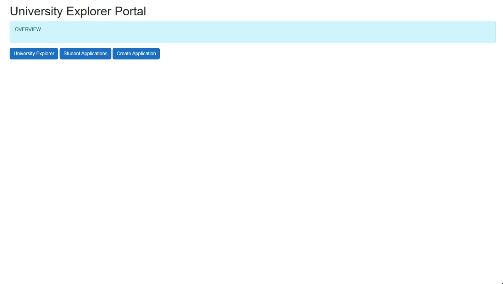
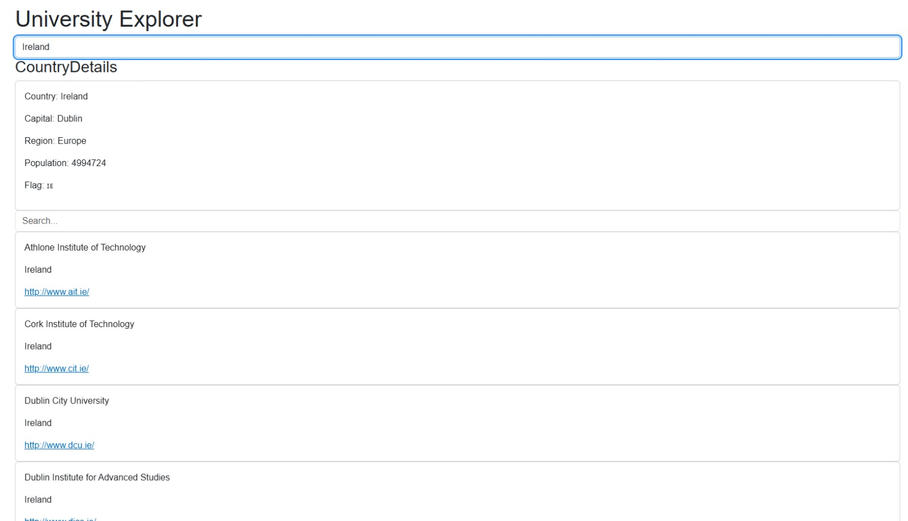
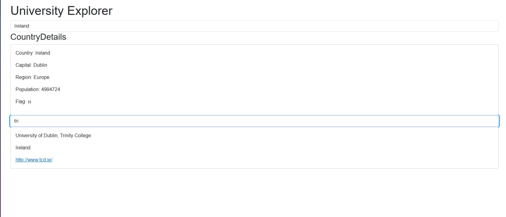
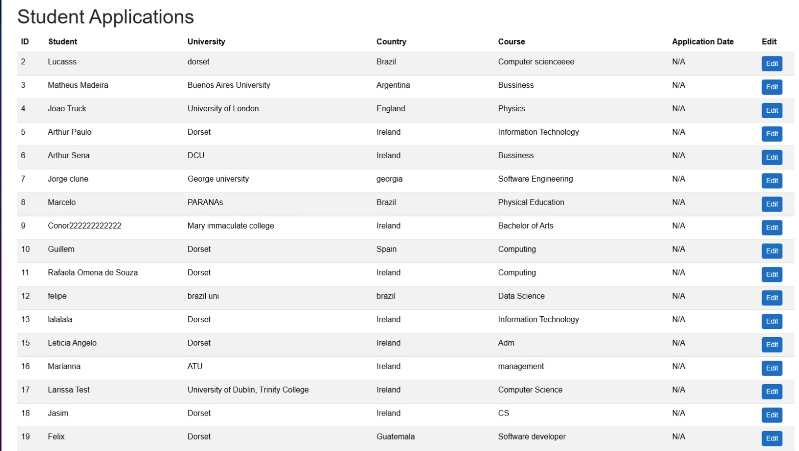
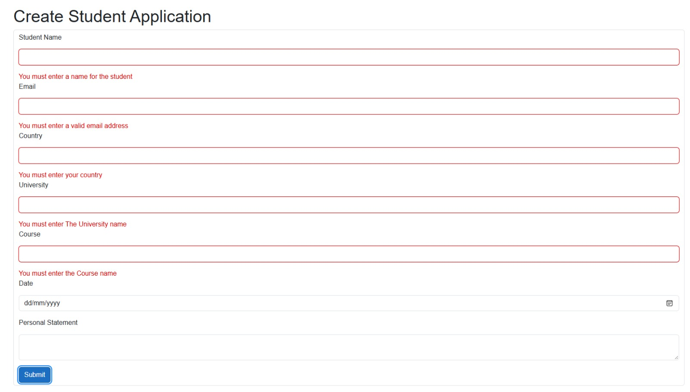
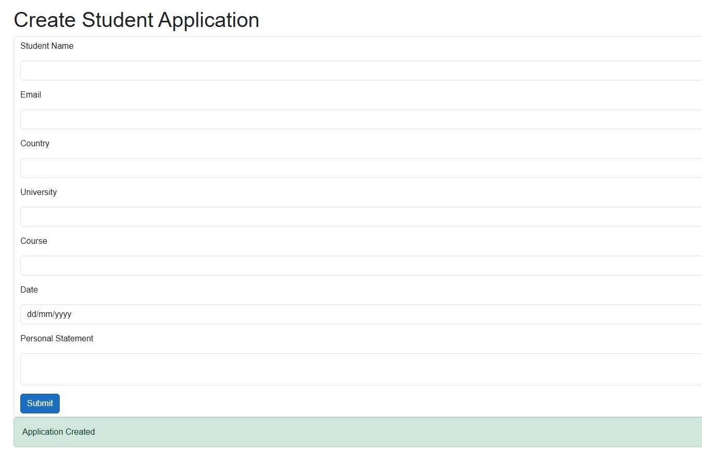
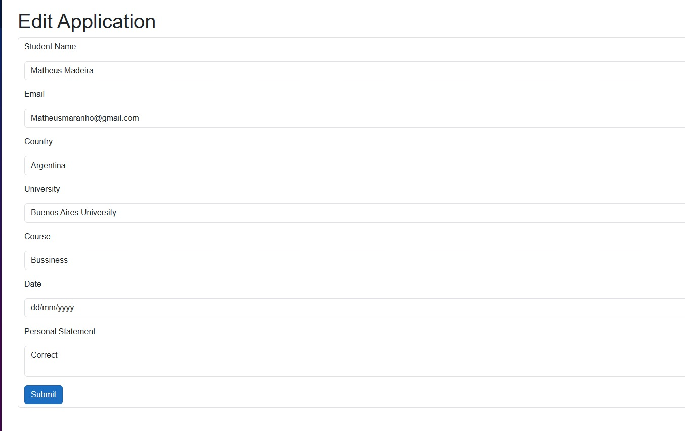

# University Explorer Portal

A **Blazor Web Application** that combines two public REST APIs (countries and universities) into a single "API mashup" experience, and integrates the **Edutots Student Application API** to create, view and edit university applications.

> **Module:** Full Stack Development, CA2 (20%)
> **Student:** `Luan` — `78684`

---

## Table of Contents

1. [Features](#features)
2. [Screenshots](#screenshots)
3. [APIs Used](#apis-used)
4. [Technology Stack](#technology-stack)
5. [Getting Started](#getting-started)
6. [Pages and Routes](#pages-and-routes)
7. [Reusable Components](#reusable-components)
8. [Project Structure](#project-structure)
9. [Design Decisions](#design-decisions)
10. [Validation Rules](#validation-rules)
11. [Requirements Coverage](#requirements-coverage)
12. [Manual Test Scenarios](#manual-test-scenarios)
13. [Known Limitations](#known-limitations)
14. [Author and AI Disclosure](#author-and-ai-disclosure)

---

## Features

**University Explorer (API mashup)**
- Loads every country from the Countries API and fills a dropdown, sorted alphabetically.
- Shows a **Country Details** card (name, capital, region, population, flag) for the selected country.
- Loads the universities of that country from the Universities API and shows them as cards (name, country, website).
- **Live search**: filters universities by name while typing, ignoring upper/lower case.
- Click a university to see its **details** (name, country, websites and domains).
- Changing the country at any time reloads the universities and clears the search and the selected university.

**Student Applications (Edutots API)**
- **View** all applications in a table with an Edit button on each row (GET).
- **Create** an application with a validated form and a success message (POST).
- **Edit** an existing application: the form is pre-filled, changes are sent to the API and the user is redirected to the list (PUT).

**General**
- Loading indicators while data is being fetched (countries, universities and applications).
- Friendly error messages when an API call fails.
- Navigation menu with links to every area of the application.

---

## Screenshots

### Home


### University Explorer


### University search and details


### Student Applications


### Create Student Application (validation)


### Create Student Application (success)


### Edit Application


---

## APIs Used

| API | Purpose | Endpoint |
|---|---|---|
| Countries API | Country selector and country details | `https://countries.dev/countries` |
| Universities API (Hipo) | Universities of the selected country | `http://universities.hipolabs.com/search?country={country}` |
| Edutots Student Application API | List, create and update applications | `https://edutots.net/api/studentapplication` (GET, POST) and `https://edutots.net/api/studentapplication/{id}` (GET, PUT) |

---

## Technology Stack

- **.NET 10** and **C#**
- **Blazor Web App** using the **Interactive Server** render mode
- **HttpClient** with typed clients registered through dependency injection
- **Data Annotations** and **EditForm** for form validation
- **Bootstrap** (included with the Blazor template) for layout and styling
- **JetBrains Rider** as the IDE and **Git/GitHub** for source control

---

## Getting Started

### Prerequisites
- [.NET 10 SDK](https://dotnet.microsoft.com/download)
- An internet connection (the application calls three external APIs)

### Run the project

```bash
git clone <repository-url>
cd <repository-folder>
dotnet run
```

Open the URL printed in the console (for example `http://localhost:5241`).
The project can also be opened and started directly from JetBrains Rider or Visual Studio.

---

## Pages and Routes

| Page | Route | Purpose |
|---|---|---|
| Home | `/` | Title, overview and navigation links |
| University Explorer | `/university-explorer` | Country selection, country details, universities, search and university details |
| Student Applications | `/student-applications` | Table of all applications with an Edit button |
| Create Student Application | `/student-applications/create` | Form to submit a new application (POST) |
| Edit Application | `/student-applications/edit/{id}` | Pre-filled form to update an application (PUT) |

---

## Reusable Components

| Component | Responsibility | Parameters |
|---|---|---|
| `CountryDetails` | Displays the selected country's information | `SelectedCountry` |
| `UniversityCard` | Summary of one university; notifies the parent when clicked | `UniversityItem`, `OnSelect` (`EventCallback<University>`) |
| `UniversityDetails` | Detailed information about the selected university | `SelectedUniversity` |
| `StudentApplicationForm` | `EditForm` with validation, shared by the Create and Edit pages | `Application`, `OnSubmit` (`EventCallback<StudentApplication>`) |

**Component communication**
- **Parent to child:** `[Parameter]` properties pass the data to display.
- **Child to parent:** `EventCallback` tells the page that a university was selected or that a form was submitted successfully. The components never call an API themselves, which keeps them reusable.

---

## Project Structure

```
University_Explorer_Portal
├── Models
│   ├── Country.cs
│   ├── University.cs
│   └── StudentApplication.cs
├── Services
│   ├── CountryService.cs
│   ├── UniversityService.cs
│   └── StudentApplicationService.cs
├── Components
│   ├── CountryDetails.razor
│   ├── UniversityCard.razor
│   ├── UniversityDetails.razor
│   ├── StudentApplicationForm.razor
│   ├── Layout
│   │   └── NavMenu.razor
│   └── Pages
│       ├── Home.razor
│       ├── UniversityExplorer.razor
│       ├── StudentApplications.razor
│       ├── CreateStudentApplication.razor
│       └── EditStudentApplication.razor
├── screenshots
└── Program.cs
```

---

## Design Decisions

- **Services separate from components.** Each API has its own service class (`CountryService`, `UniversityService`, `StudentApplicationService`). Pages ask the service for data, so the HTTP details live in one place.
- **Typed HttpClients.** Each service is registered with `AddHttpClient<T>()` in `Program.cs` with its own base address.
- **Interactive Server render mode.** API calls run on the server, which avoids browser CORS restrictions and mixed-content problems (the Universities API is served over `http`).
- **One form for two pages.** `StudentApplicationForm` receives the model as a parameter and reports a valid submit through an `EventCallback`. The Create page passes an empty object and calls POST; the Edit page passes the loaded application and calls PUT.
- **Calculated properties for UI state.** The selected country and the filtered university list are calculated from the current selection and search text, so they always stay in sync without extra update code.
- **Safe API calls.** `PostAsJsonAsync` and `PutAsJsonAsync` do not throw on error status codes, so `EnsureSuccessStatusCode()` is called to make failures reach the page's `try/catch` and show an error message.
- **Separate loading and error state per data source.** Countries and universities each have their own loading and error flags, so loading universities does not hide the country dropdown.
- **Encoded query values.** The country name is passed through `Uri.EscapeDataString` before it is placed in the Universities API URL, so names with spaces (such as "United States") work.

---

## Validation Rules

Validation uses Data Annotations on the `StudentApplication` model. Messages are shown next to each field.

| Field | Rule |
|---|---|
| Student Name | Required |
| Email | Required and must be a valid email address |
| Country | Required |
| University | Required |
| Course | Required |
| Application Date | Optional (see [Known Limitations](#known-limitations)) |
| Personal Statement | Optional |

---

## Requirements Coverage

| # | Requirement | Where it is implemented |
|---|---|---|
| 1 | University Explorer (API mashup) | `UniversityExplorer.razor`, `CountryService`, `UniversityService` |
| 2 | Country selection | Country dropdown in `UniversityExplorer.razor` |
| 3 | Country details | `CountryDetails.razor` |
| 4 | Universities list | `UniversityCard.razor` rendered per university |
| 5 | University search | Search box bound with `@bind:event="oninput"` and a filtered list |
| 6 | University details | `UniversityDetails.razor` |
| 7 | View student applications (GET) | `StudentApplications.razor` |
| 8 | Create student application (POST) | `CreateStudentApplication.razor`, `StudentApplicationForm.razor` |
| 9 | Edit student application (PUT) | `EditStudentApplication.razor` |
| 10 | Validation | Data Annotations in `StudentApplication.cs` with `DataAnnotationsValidator` and `ValidationMessage` |
| 11 | Loading state | Countries, universities, applications and the edit page |
| 12 | Error handling | `try/catch` around every API call with `alert alert-danger` messages |
| 13 | Reusable components | `CountryDetails`, `UniversityCard`, `UniversityDetails`, `StudentApplicationForm` |
| 14 | EventCallback | `UniversityCard.OnSelect` and `StudentApplicationForm.OnSubmit` |

---

## Manual Test Scenarios

| Scenario | Expected result |
|---|---|
| Open University Explorer | "Loading..." appears, then the sorted country dropdown |
| Select Ireland | Country details card and a list of Irish universities |
| Select a country with a space in its name (e.g. United States) | Universities load without errors |
| Select "Select Country" again | Universities, search text and university details are cleared |
| Type `trinity` and then `TRINITY` in the search box | The same results, updated while typing |
| Search for text that matches nothing | A "no universities" message, with the search box still available |
| Click a university card | University details panel shows the selected university |
| Submit the create form empty | Validation messages appear and nothing is sent |
| Enter `abc` as the email | Email validation message appears |
| Submit a valid application | Success message, form is cleared, application appears in the list |
| Click Edit on an application | Form opens pre-filled with its data |
| Change the course and save | Redirect to the list showing the updated course |
| Open an edit URL for an id that does not exist | A friendly "not found" or error message |

---

## Known Limitations

- **Application Date is not stored by the API.** The Edutots API returns no date field, so a date entered in the form is accepted but not saved, and the "Application Date" column in the list shows "N/A". The field is therefore optional in the form. This limitation of the API is known.
- **Country names may differ between the two APIs.** A country name from the Countries API can be spelled differently in the Universities API, in which case no universities are returned for that country.
- **Flag display.** On some systems (notably Windows) flag emojis may be shown as two-letter country codes instead of a flag image.
- **No delete or pagination.** The assignment only requires viewing, creating and editing, so these were not implemented.
- **Shared test data.** The Edutots API is shared, so the application list can contain entries created by other students.

---

## Author and AI Disclosure

Project developed by `Luan` for the Full Stack Development module (CA2).

This `README.md` was written by **Claude**, an AI assistant made by Anthropic, at the student's request, based on the structure and behaviour of the project.
